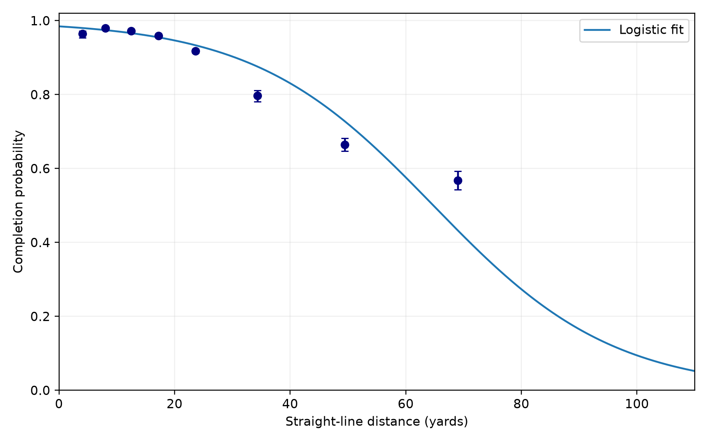

# UFA 2025 throws

84,099 coordinate-complete attempts from 157 games, 79,125 completions (94.09%). Extracted throw table: `throws_2025.csv`; raw owner-supplied cache: 15 MB, excluded via data/.gitignore.

## Semantics and quality

Quality filter: the extracted CSV retains all 85,279 attempts; all statistics and the fit below exclude 1,180 throws with distance <1 yard. Many turnover records repeat the thrower coordinates (748 exact-zero type 22, 91 exact-zero type 20; also 221 zero completions). These plausibly indicate unrecorded endpoints, not real zero-yard throws. The 1-yard threshold is an explicit sensitivity/quality decision, not an API missingness label. Counts and estimates are conditional on recorded distance ≥1 yard; missing endpoints may be outcome-dependent.

The official API documentation https://www.docs.ufastats.com/ returned a JavaScript-only shell. Numeric meanings are therefore **inferred from fields and event sequences**, not confirmed documentation: 18 completed pass; 19 goal pass; 20 drop; 22 throwaway. Types 18/19 count completed; 20/22 incomplete. Drop vs throwaway naming needs independent verification but both count identically in this analysis. Type 11/12 defender-only block/Callahan records have no throw endpoints and are not counted again; offensive turnover counterparts are represented by type 22. Type 23 appears to be a stall (identical endpoints), excluded; 24 lacks destination, excluded. No endpoint imputation. Event counts: {"1": 6687, "2": 6685, "3": 800, "5": 760, "7": 6183, "8": 455, "9": 36, "10": 7, "11": 3117, "12": 26, "13": 2807, "14": 67, "15": 6129, "16": 1675, "17": 2052, "18": 73246, "19": 6128, "20": 862, "22": 5043, "23": 25, "24": 67, "25": 640, "28": 314, "29": 314, "30": 314, "31": 304, "32": 26, "33": 11}.

Both streams represent their own offensive throws. Coordinates are interpreted as yards, x across field, y increasing toward attack (goal locations provide a check). Incomplete type 22 uses turnoverX/Y, which is a turnover endpoint, not necessarily the intended receiver location. This introduces distance measurement error. Distance is Euclidean, not flight path. Rates already include real defense: applying additional defender penalties may double-count pressure.

## Distance completion

| Group | Attempts | Completed | Rate (95% Wilson CI) |
|---|---:|---:|---|
| 0–5 yd | 1,506 | 1,452 | 96.41% (95.35%–97.24%) |
| 5–10 yd | 17,780 | 17,425 | 98.00% (97.79%–98.20%) |
| 10–15 yd | 28,769 | 27,977 | 97.25% (97.05%–97.43%) |
| 15–20 yd | 18,250 | 17,495 | 95.86% (95.56%–96.14%) |
| 20–30 yd | 10,871 | 9,977 | 91.78% (91.24%–92.28%) |
| 30–40 yd | 2,612 | 2,081 | 79.67% (78.08%–81.17%) |
| 40–60 yd | 2,786 | 1,852 | 66.48% (64.70%–68.20%) |
| 60–120 yd | 1,525 | 866 | 56.79% (54.29%–59.25%) |

Bernoulli maximum-likelihood fit using all attempts, d in yards:

`p_UFA(d) = 1 / (1 + exp(-(4.15701518 + (-0.06417449) * d)))`

Descriptive one-variable fit; no causal or out-of-range guarantees. Wilson intervals assume independent throws and may be optimistic due to clustering. Grid squares-to-yards is a separate simulator design choice.



## Direction

Forward dy>2 yards, lateral |dy|≤2, backward dy<−2; threshold is an explicit analysis choice.

| Group | Attempts | Completed | Rate (95% Wilson CI) |
|---|---:|---:|---|
| Forward | 56,998 | 52,636 | 92.35% (92.13%–92.56%) |
| Lateral | 10,300 | 10,066 | 97.73% (97.42%–98.00%) |
| Backward / dump | 16,801 | 16,423 | 97.75% (97.51%–97.96%) |

## Break-side geometry proxy

No force, break, marker orientation, release type or defender-position field occurs in the cached schema. Keys: defender, line, pullMs, pullX, pullY, puller, receiver, receiverX, receiverY, thrower, throwerX, throwerY, time, timestamp, turnoverX, turnoverY, type. True break/open throws cannot be identified.

A weak, explicitly geometric proxy compares lateral-dominant throws (|dx|>|dy|) crossing field center (thrower_x × receiver_x < 0), against lateral-dominant throws staying on the same side. Cross-center can be open and same-side can break; these are **not labeled break/open statistics**.

| Group | Attempts | Completed | Rate (95% Wilson CI) |
|---|---:|---:|---|
| Cross-center proxy | 18,996 | 18,325 | 96.47% (96.20%–96.72%) |
| Same-side comparison | 24,362 | 23,764 | 97.55% (97.34%–97.73%) |

Direct standardization to pooled distance-bin weights, restricted to bins with ≥20 in both groups: cross-center 97.51%, same-side 97.26%, ratio **1.0026**; game-cluster bootstrap 95% interval **[0.9994, 1.0061]**, 500 resamples, seed 2025. Controls binned distance only; selection, players, wind and defense remain confounded.

**Recommended evidence-based break multiplier: 1.00.** No nontrivial force-side penalty is identifiable from these fields. If required for game design, choose a clearly assumed sensitivity parameter such as 0.9 or 0.8 and report sensitivity; do not call it a UFA estimate. The proxy ratio is a diagnostic, not a calibrated force penalty.

## Reproduce

Owner fetched the unauthenticated endpoints below. Note `date=2025`, not `years=2025`.

```sh
mkdir -p data/raw/events
curl --fail 'https://www.backend.ufastats.com/api/v1/games?date=2025' -o data/raw/games_2025.json
# Repeat for each gameID (157 cached games):
curl --fail "https://www.backend.ufastats.com/api/v1/gameEvents?gameID=$gameID" -o "data/raw/events/$gameID.json"
uv run python data/analyze_throws.py
```

Analysis uses existing numpy/matplotlib dependencies; no network calls. Event semantics remain inferred until documentation can be independently read.
